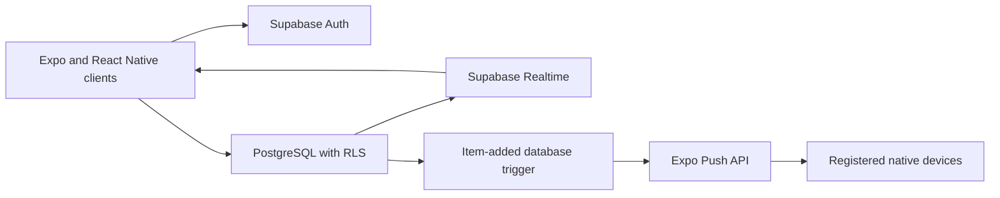

# Ruby

Shared lists with live updates across web and mobile, built with React Native, Expo, TypeScript, and Supabase.

[Open the web app](https://ruby-lists.vercel.app) · [Two-minute walkthrough and case study](docs/SHOWCASE.md) · [Detailed technical guide](docs/TECHNICAL_GUIDE.md)

Create a list, invite another registered user by email, and add or complete items from two sessions. PostgreSQL stores the data and enforces access policies; Supabase Realtime delivers row updates to connected clients.

## What to assess

- Email authentication and shared-list workflows.
- Live insertion, completion, and deletion updates.
- PostgreSQL Row-Level Security and owner-controlled invitations.
- Light and dark themes, animated list interactions, and in-app notifications.
- Native push-token registration and a database trigger that sends item-added notifications through Expo Push.

The app targets web, iOS, and Android from one codebase. This does not imply a published App Store release. Push delivery requires a configured native build and device permissions; it is not available through the web implementation.

## Try the main workflow

1. Open the web app and create an account; complete email confirmation if prompted.
2. Create a list and add a few items.
3. In a second browser profile, sign in with another registered account.
4. Invite that account from the list owner's session.
5. Add, check, and delete items while observing both sessions.

The prior README advertised a shared demo account. Its current availability has not been verified, so account creation is the documented path here. Avoid putting personal information in a shared demonstration account.

## Architecture



Core tables are `profiles`, `lists`, `list_members`, `items`, and `push_tokens`. The `add_list_member` function looks up invitations server-side and checks list ownership. UI filtering is not a replacement for database permissions.

## Code worth reading

| Area | Entry point |
| --- | --- |
| Schema, policies, invitations, push trigger | [schema.sql](supabase/schema.sql) |
| Item loading and live updates | [use-items.ts](src/hooks/use-items.ts) |
| List subscriptions | [use-lists.ts](src/hooks/use-lists.ts) |
| Native push registration | [push.ts](src/lib/push.ts) |
| Authentication | [auth.tsx](src/lib/auth.tsx) |

`useItems` handles inserts, updates, and deletes separately and removes its subscription on cleanup. Delete handling matches the removed item's primary key; it does not assume a full deleted row is present in the event.

## Local setup

Use Node.js 22 or later and a separate Supabase project for development. The locked Supabase dependency requires Node.js 22 or later. See the [technical guide](docs/TECHNICAL_GUIDE.md#run) for database setup, existing-schema caveats, avatar storage, and platform configuration.

```sh
npm ci
```

Copy `.env.example` to `.env`, then set `EXPO_PUBLIC_SUPABASE_URL` and `EXPO_PUBLIC_SUPABASE_ANON_KEY` to your project's URL and publishable/anon key. Apply `supabase/schema.sql` to your development database and verify Realtime is enabled for the relevant tables. Never put a service-role key in client configuration.

```sh
npm run web
```

For native development, `npm start` starts Expo with a development client. Native push additionally requires an EAS project, a development or production build, a physical device, notification permission, and platform credentials. The SQL push trigger uses `pg_net`; inspect delivery on your own configured backend before demonstrating it.

The repository includes EAS profiles and Vercel configuration. Replace project-specific settings when deploying your own instance. A web export uses `npx expo export -p web`.

## Current limitations and verification

- Offline-first synchronization is not documented as complete.
- Native push code exists, but delivery depends on external configuration and was not verified during this documentation update.
- No automated `test` script is defined in `package.json`.
- No measured synchronization-latency guarantee is claimed.
- Screenshot files previously linked by this README are absent. The [capture plan](docs/SHOWCASE.md#capture-plan) describes the real screenshots to add.

Built by [Mustafa Alhasson](https://github.com/pascalmmk).
